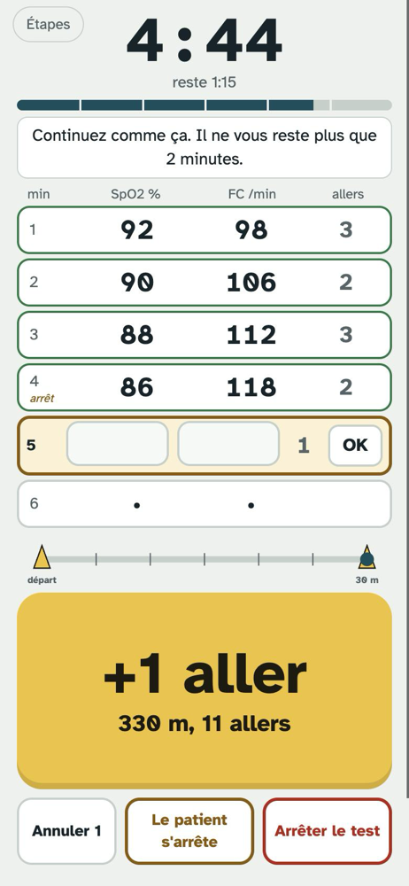
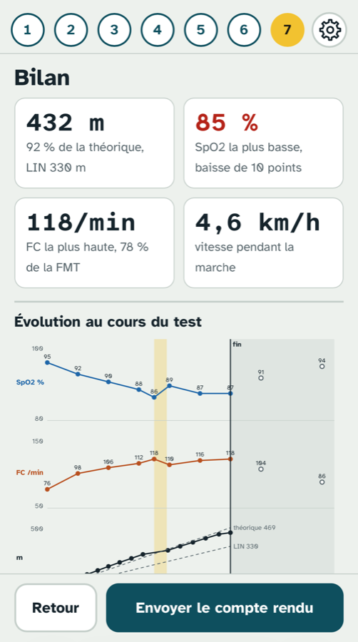
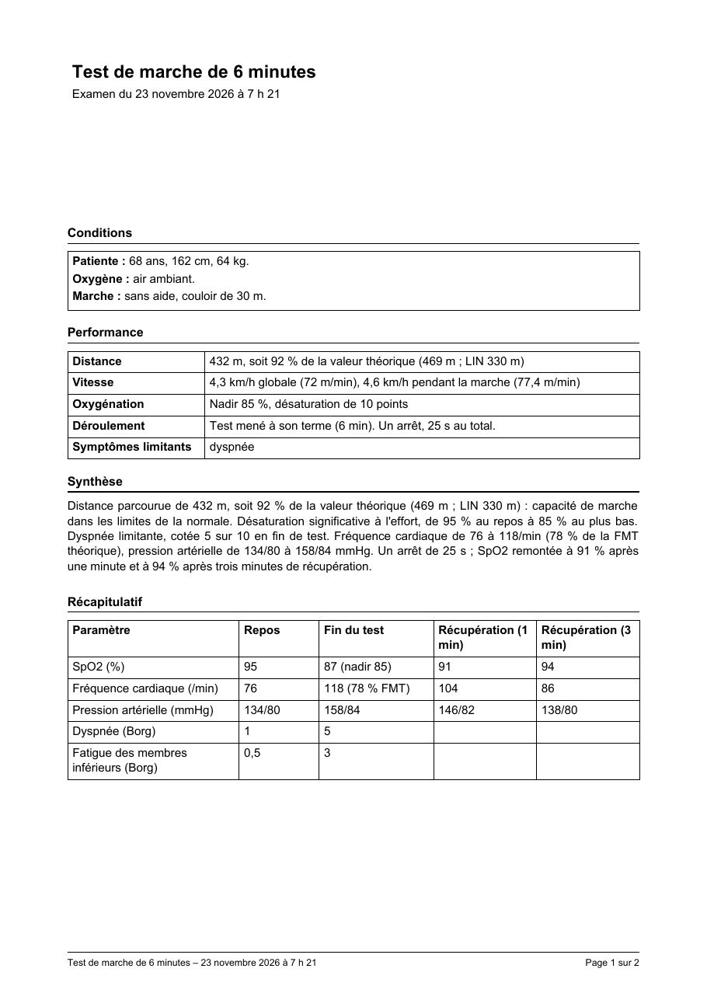
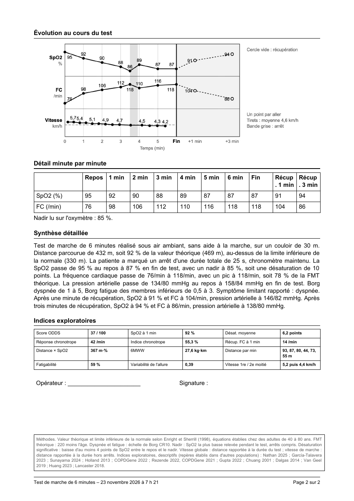

# TM6 — test de marche de 6 minutes

*[English](README.md) · Français*

TM6 est une application web qui accompagne l'opérateur pendant un test de marche de 6 minutes ou une titration de l'oxygène à l'effort, puis produit un compte rendu Word prêt à être envoyé. Elle s'utilise sur iPad, iPhone ou téléphone Android, s'installe depuis le navigateur et fonctionne ensuite sans réseau. Son interface est en français ou en anglais : elle suit la langue de l'appareil, et un réglage permet de choisir la langue. En anglais, elle s'appelle 6MWT, abréviation de *six-minute walk test*.

**Ouvrir l'application : https://wanderingpacemaker.github.io/tm6/**

Pour un premier test, suivre le [guide pas à pas](TUTORIEL.md), illustré de captures d'écran.

  
  &nbsp;
  

## Ce que fait l'application

Le test se déroule en sept étapes, toujours accessibles depuis la barre du haut, si bien qu'on peut revenir corriger une donnée à tout moment, y compris pendant la marche. Aucune donnée manquante ne bloque le parcours : les calculs se refont dès qu'elle est saisie.

L'opérateur renseigne d'abord le **patient** (sexe, âge, taille, poids), ce qui affiche la distance théorique et sa limite inférieure. Il précise ensuite les **conditions** : type d'examen, oxygène (interface, mode continu ou pulsé, débit ou réglage, source), aide à la marche ; la longueur du couloir est fixée une fois pour toutes dans les réglages, de même que l'emplacement de la ligne de départ quand le patient ne part pas d'un plot (par exemple depuis une salle située au milieu du couloir). Au **repos**, il note SpO2, FC, pression artérielle et cotation de Borg (dyspnée puis fatigue), l'échelle étant présentée en plein écran face au patient, qui ne touche jamais l'appareil. L'écran **Prêt** affiche les consignes standardisées à lire au patient.

Le chronomètre ne part qu'au **départ**. Pendant le **test**, l'opérateur compte les allers d'un toucher, l'heure de chaque passage étant enregistrée pour calculer la vitesse ; l'application affiche les encouragements standardisés de la norme, demande à chaque minute la SpO2 et la FC lues sur l'oxymètre, et signale une SpO2 inférieure à 80 %. Les arrêts sont horodatés, avec leurs mesures facultatives et la phrase de reprise. En titration, les changements de débit ou de réglage d'oxygène sont horodatés eux aussi.

À la fin, un minuteur rappelle les relevés de **récupération** à 1 et 3 minutes, et l'opérateur note la distance partielle, la cotation de Borg de fin et les symptômes limitants. Le **bilan** réunit la distance, la SpO2 la plus basse, la FC la plus haute, la vitesse de marche, une figure de l'évolution au cours du test, une synthèse et des indices exploratoires.

## Le compte rendu

« Envoyer le compte rendu » construit un document Word de deux pages au plus, en noir et gris, avec un emplacement libre en haut à droite pour l'étiquette du patient. La première page présente les conditions du test, un tableau de performance (distance, vitesse, oxygénation, déroulement, symptômes), la synthèse et un récapitulatif des mesures. La seconde porte une figure polygraphique sur un axe de temps unique (SpO2, FC, vitesse de chaque aller, oxygène), le détail minute par minute, la synthèse détaillée, un tableau des indices exploratoires et, en bas de page, un encart de méthodes qui cite les références utilisées.

Le document est transmis par la feuille de partage du système : on choisit Mail, Fichiers ou toute autre application.

Exemple, produit par l'application à partir de son test de démonstration (patiente fictive, en-tête laissé vide) : [compte rendu Word](exemples/compte-rendu-exemple.docx), et la même chose [en PDF](exemples/compte-rendu-exemple.pdf) pour le lire directement dans GitHub. Le compte rendu est rédigé dans la langue de l'application.

  
  &nbsp;
  

## Installer

L'application s'installe depuis le navigateur, sans magasin d'applications ni compte.

- **iPhone et iPad** : ouvrir l'adresse dans Safari, toucher le bouton Partager, puis « Sur l'écran d'accueil ».
- **Android** : ouvrir l'adresse dans Chrome, puis choisir « Installer l'application » ou « Ajouter à l'écran d'accueil » dans le menu.

Une notice d'une page à imprimer, avec un QR code vers l'application, est disponible en Word : [Installer-TM6.docx](Installer-TM6.docx).

La première ouverture doit se faire avec du réseau pour que l'application se mette en mémoire ; elle fonctionne ensuite sans connexion. Quand une nouvelle version est publiée, elle est prise en compte au lancement qui suit.

## Données et confidentialité

Aucune donnée ne quitte l'appareil. Le test en cours, les réglages et la liste des dispositifs d'oxygène sont conservés dans le stockage local du navigateur ; il n'y a ni serveur, ni compte, ni mesure d'audience. Le serveur ne fait que fournir les fichiers de l'application. Le compte rendu n'est envoyé que lorsque l'opérateur le partage lui-même.

Un test interrompu (fermeture de l'application, appel) est restauré à la réouverture pendant 12 heures. Sur iPhone et iPad, il faut utiliser l'application installée sur l'écran d'accueil plutôt que l'onglet de Safari, dont iOS peut effacer les données d'un site peu visité.

## Références

L'application suit la norme technique ERS/ATS de 2014, et l'énoncé de l'ATS de 2002 là où la norme de 2014 ne dit rien. En anglais, les textes dits au patient (consignes, encouragements, échelle de Borg) sont ceux des normes d'origine.

- Holland AE, Spruit MA, Troosters T, et al. An official European Respiratory Society/American Thoracic Society technical standard: field walking tests in chronic respiratory disease. *Eur Respir J* 2014;44:1428-46. doi:10.1183/09031936.00150314 — consignes au patient, encouragements, conduite à tenir lors des arrêts et en cas de désaturation.
- ATS Committee on Proficiency Standards for Clinical Pulmonary Function Laboratories. ATS statement: guidelines for the six-minute walk test. *Am J Respir Crit Care Med* 2002;166:111-7. doi:10.1164/ajrccm.166.1.at1102 — échelle de Borg modifiée (tableau 2, traduction de travail) et rappel à l'opérateur.
- Enright PL, Sherrill DL. Reference equations for the six-minute walk in healthy adults. *Am J Respir Crit Care Med* 1998;158:1384-7. doi:10.1164/ajrccm.158.5.9710086 — distance théorique et limite inférieure de la normale, établies chez des adultes de 40 à 80 ans.
- Nathan SD, et al. *Eur Respir J* 2025;66:2402565. doi:10.1183/13993003.02565-2024 — score ODDS, affiché dans le bilan et le compte rendu, validé dans la fibrose pulmonaire idiopathique seulement.

Le détail de chaque calcul (formule, données utilisées, raison du choix et source) est dans [METHODES.md](METHODES.md).

Les autres indices exploratoires du bilan sont descriptifs : leurs repères ont été établis dans d'autres populations et ne donnent lieu à aucun verdict. Chacun est affiché avec sa formule et sa source (auteur et année), que l'encart Méthodes du compte rendu reprend.

## Fichiers

Ce dépôt contient l'application telle qu'elle est servie : `index.html` (toute l'application, en HTML et JavaScript sans bibliothèque, y compris la fabrication du fichier Word), les polices Atkinson Hyperlegible, l'icône, le manifeste et `sw.js`, qui met l'application en mémoire pour l'usage sans réseau. L'historique des versions est dans [NOTES-DE-VERSION.md](NOTES-DE-VERSION.md).

Le code est publié pour être lu ; aucune licence de réutilisation n'est accordée (tous droits réservés).
