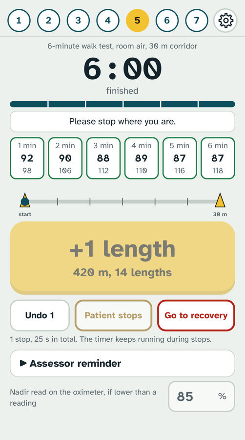
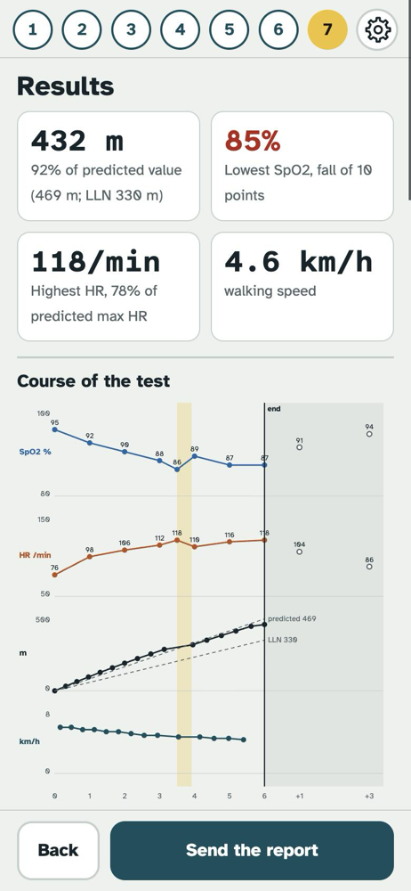
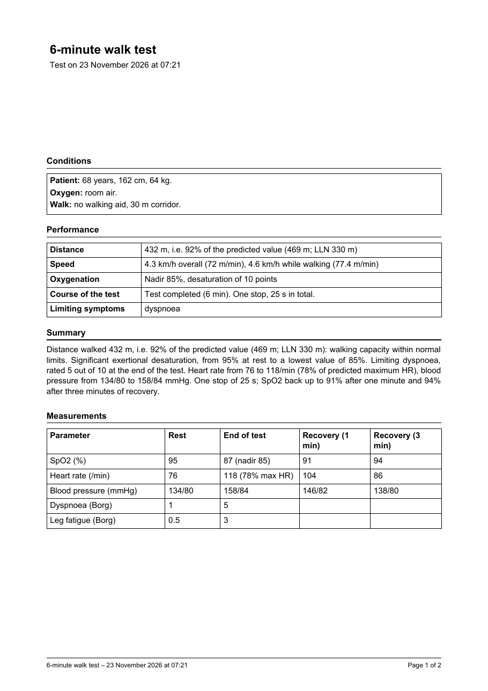
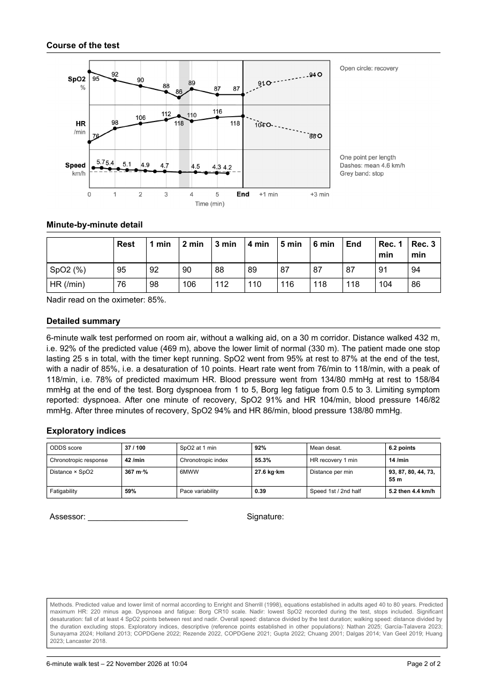

# 6MWT — 6-minute walk test

*English · [Français](README.fr.md)*

6MWT, called TM6 in its French version, is a web app that guides the assessor through a 6-minute walk test or an exertional oxygen titration, then produces a Word report ready to be sent. It runs on iPad, iPhone or Android phones, installs from the browser and then works offline. Its interface is in French or English: it follows the language of the device, and a setting chooses the language.

**Open the app: https://wanderingpacemaker.github.io/tm6/**

A step-by-step guide to a first test, with screenshots: [TUTORIAL.md](TUTORIAL.md).

  
  &nbsp;
  

## What the app does

The test runs through seven steps, always reachable from the top bar, so any value can be corrected at any time, including during the walk. A missing value never blocks the workflow: calculations are redone as soon as it is entered.

The assessor first enters the **patient** (sex, age, height, weight), which displays the predicted distance and its lower limit of normal. The **conditions** come next: type of test, oxygen (interface, continuous or pulsed flow, flow or setting, source) and walking aid. The corridor length is set once and for all in the settings, as is the position of the starting line when the patient does not start at a cone (for example from a room halfway along the corridor). At **rest**, the assessor records SpO2, heart rate, blood pressure and the Borg ratings (dyspnoea, then fatigue); the scale is shown full screen to the patient, who never touches the device. The **Ready** screen displays the standardised instructions to read to the patient.

The timer starts only at **START**. During the **test**, the assessor counts each length with one tap, and the time of each passage is recorded to compute walking speed. The app displays the standardised encouragement of the technical standard, asks every minute for the SpO2 and heart rate read on the oximeter, and flags an SpO2 below 80%. Stops are time-stamped, with their optional measurements and the phrase to resume walking. During a titration, changes in oxygen flow or setting are time-stamped too.

At the end, a timer prompts the **recovery** readings at 1 and 3 minutes, and the assessor enters the final partial length, the end-of-test Borg ratings and the limiting symptoms. The **results** screen brings together distance, lowest SpO2, highest heart rate, walking speed, a figure of the course of the test, a summary and exploratory indices.

## The report

"Send the report" builds a Word document of no more than two pages, in black and grey, with an empty space at the top right for the patient label. The first page presents the test conditions, a performance table (distance, speed, oxygenation, course of the test, symptoms), the summary and an overview of the measurements. The second page carries a polygraph-style figure on a single time axis (SpO2, heart rate, speed of each length, oxygen), the minute-by-minute detail, the detailed summary, a table of exploratory indices and, at the bottom of the page, a methods box citing the references used.

The document is passed to the system share sheet: choose Mail, Files or any other app.

Example produced by the app from its demonstration test (fictitious patient, empty header): [Word report](exemples/example-report.docx), and the same [as a PDF](exemples/example-report.pdf) to read it directly on GitHub. The report is written in the language of the app.

  
  &nbsp;
  

## Installing

The app installs from the browser, with no app store and no account.

- **iPhone and iPad**: open the address in Safari, tap the Share button, then "Add to Home Screen".
- **Android**: open the address in Chrome, then choose "Install app" or "Add to Home screen" from the menu.

A one-page printable notice with a QR code to the app is available as a Word file: [Install-6MWT.docx](Install-6MWT.docx).

The first launch must be online so that the app can be stored on the device; it then works without a connection. When a new version is published, it is picked up at the next launch.

## Data and privacy

No data leaves the device. The current test, the settings and the list of oxygen devices are kept in the browser's local storage; there is no server, no account and no analytics. The server only delivers the app files. The report is sent only when the assessor shares it.

An interrupted test (app closed, phone call) is restored on reopening for up to 12 hours. On iPhone and iPad, use the app installed on the home screen rather than a Safari tab, because iOS may erase the data of a rarely visited website.

## References

The app follows the ERS/ATS technical standard of 2014, and the ATS statement of 2002 where the 2014 standard is silent. The English texts said to the patient (instructions, encouragement, Borg scale) are those of the original standards.

- Holland AE, Spruit MA, Troosters T, et al. An official European Respiratory Society/American Thoracic Society technical standard: field walking tests in chronic respiratory disease. *Eur Respir J* 2014;44:1428-46. doi:10.1183/09031936.00150314 — instructions to the patient, encouragement, management of stops and of desaturation.
- ATS Committee on Proficiency Standards for Clinical Pulmonary Function Laboratories. ATS statement: guidelines for the six-minute walk test. *Am J Respir Crit Care Med* 2002;166:111-7. doi:10.1164/ajrccm.166.1.at1102 — modified Borg scale (table 2) and reminders for the assessor.
- Enright PL, Sherrill DL. Reference equations for the six-minute walk in healthy adults. *Am J Respir Crit Care Med* 1998;158:1384-7. doi:10.1164/ajrccm.158.5.9710086 — predicted distance and lower limit of normal, established in adults aged 40 to 80 years.
- Nathan SD, et al. *Eur Respir J* 2025;66:2402565. doi:10.1183/13993003.02565-2024 — ODDS score, shown in the results and the report, validated in idiopathic pulmonary fibrosis only.

Each calculation (formula, data used, reason for the choice and source) is detailed in [METHODS.md](METHODS.md).

The other exploratory indices in the results are descriptive: their reference points were established in other populations and lead to no verdict. Each one is shown with its formula and source (author and year), which the methods box of the report repeats.

## Files

This repository contains the app as it is served: `index.html` (the whole app, in HTML and JavaScript without any library, including the Word file generation), the Atkinson Hyperlegible fonts, the icon, the manifest and `sw.js`, which stores the app for offline use. The version history is in [RELEASE-NOTES.md](RELEASE-NOTES.md).

The code is published to be read; no licence to reuse it is granted (all rights reserved).
