# First test with 6MWT

*English · [Français](TUTORIEL.md)*

This guide walks through a first 6-minute walk test with 6MWT, from the settings to sending the report. The screenshots come from an iPhone; on iPad, the steps are the same, arranged in a column on the left of the screen. To install the app, see the [installation notice](Install-6MWT.docx) or the "Install" section of the [README](README.md).

The test runs in seven steps, numbered at the top of the screen. A number can be tapped at any time to go back and correct a value, including during the walk, and nothing blocks if a value is missing: calculations are redone as soon as it is entered.

## Before the first patient: the settings

The gear wheel, at the top right, opens the settings. They are set once and kept on the device.

  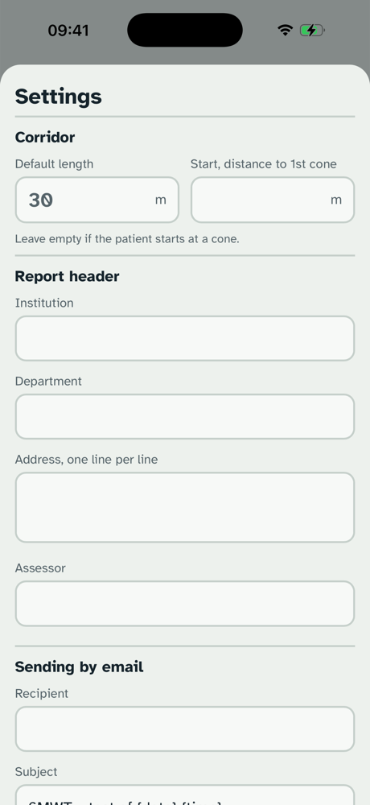
  &nbsp;
  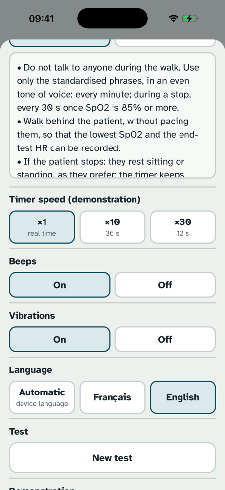

First enter the **corridor length**. If the patient does not start at a cone, for example from a room halfway along the corridor, also enter the **distance between the starting line and the first cone**; leave this field empty if the start is at a cone. The **report header** (institution, department, address, assessor) will appear at the top of the Word document.

Further down, the **instructions to the patient** are those of the ERS/ATS standard; they can be replaced by the department's own text. The **assessor reminder** summarises how the test is run and can be hidden. The **timer speed** must stay on "×1, real time" for a real test: the ×10 and ×30 speeds are only for trying out the app. They are shown on the START button and on the timer, and the speed returns to ×1 with each new test. The **language** setting chooses between French and English; on "Automatic", the app follows the language of the device.

At the very bottom, the "Fill in a sample test and open the results" button loads a complete fictitious test: it is the quickest way to see the results and the report before the first patient. The "New test" button erases the test in progress.

## 1. Patient

Choose the sex, then enter age, height and weight. The predicted distance (Enright and Sherrill equation) and its lower limit of normal are shown as soon as everything is entered.

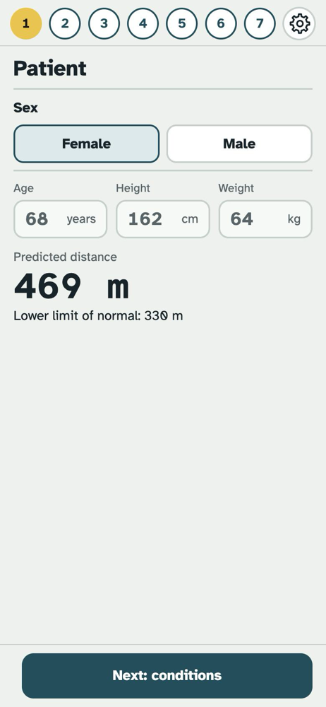

## 2. Conditions

Choose the type of test, 6-minute walk test or exertional oxygen titration, then oxygen and walking aid. If the patient is on oxygen, further lists appear: interface, continuous or pulsed mode, flow or setting, source. The corridor length is recalled below the lists, with a link to change it.

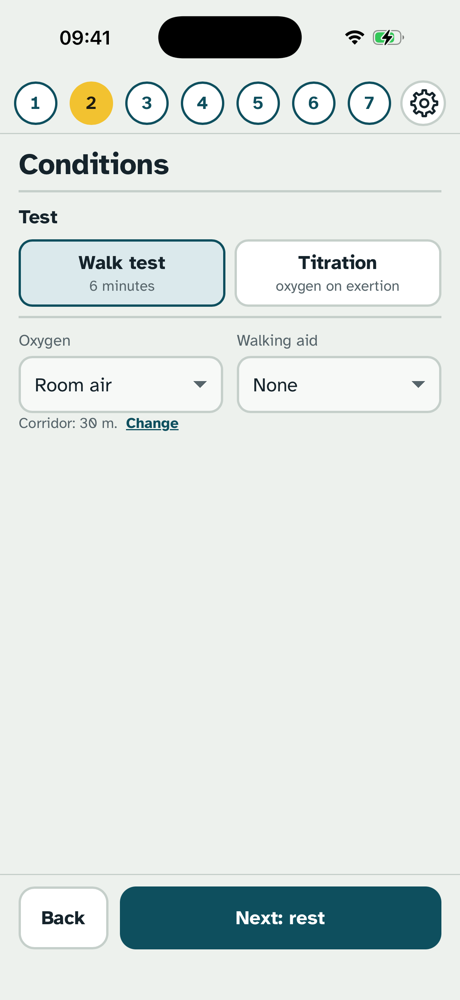

## 3. Rest

The patient has been sitting at rest for at least 15 minutes. Enter SpO2, HR and blood pressure, then have the patient rate dyspnoea and fatigue.

  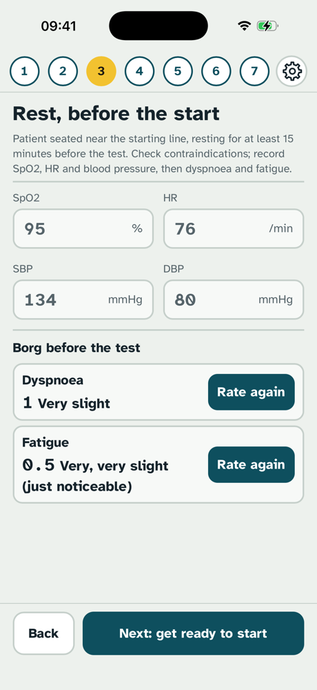
  &nbsp;
  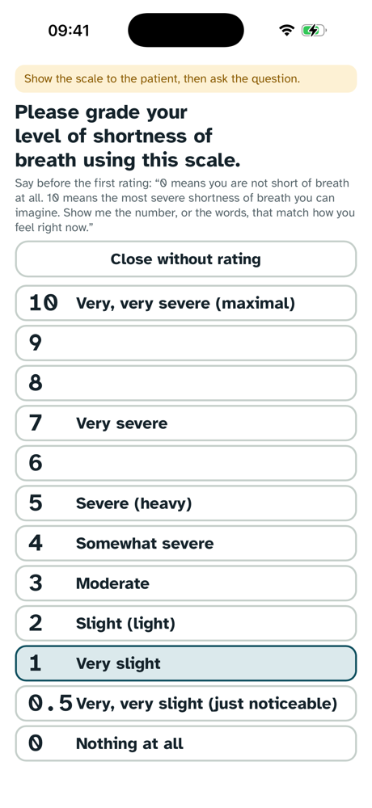

"Show the scale" displays the Borg scale full screen. Turn it towards the patient, who does not touch the device: they point to or say their rating, and the assessor taps the corresponding line. The sentence to say before the first rating is written at the top of the scale.

## 4. Ready to start

The screen shows the instructions to read to the patient. The three boxes (instructions read, oximeter in place, patient on the starting line) are a reminder and block nothing. The timer starts only when **START** is tapped.

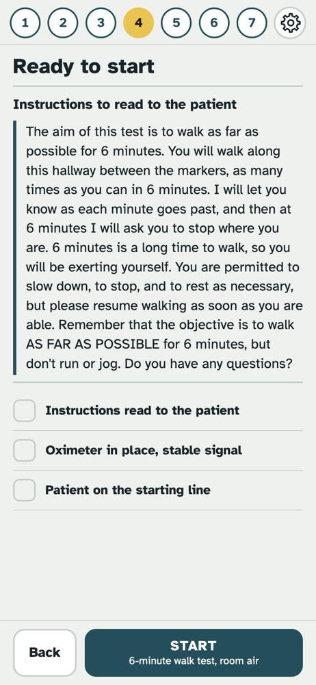

## 5. Test

The timer and the time left are at the top, with the encouragement to say to the patient, which changes every minute. Each time the patient reaches a cone, tap the large yellow **+1 length** button: the time of each length is used to calculate speed, and the corridor drawing shows where the patient is. "Undo 1" removes the last length counted. Two taps less than 3 seconds apart count as a single length. A forgotten length can be added after the end of the test: it counts in the distance but not in the speed, since its time is unknown.

  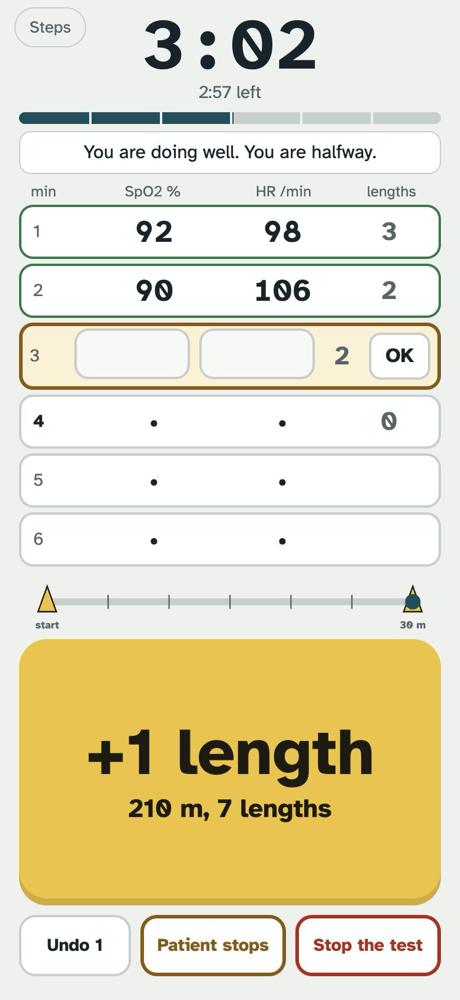
  &nbsp;
  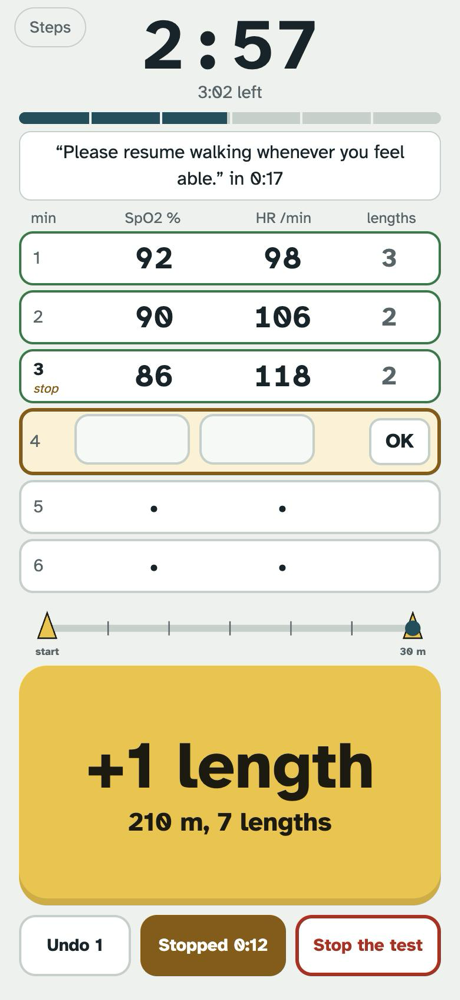

On iPhone, a table of the six minutes fills the middle of the screen: for each minute, the SpO2 and HR read on the oximeter, and the number of lengths walked during that minute. The row of the minute to fill in opens on its own; enter both values there and tap "OK". Any row can be tapped to fill it in or correct it, at any time, including later. On iPad, a card asks for the same values every minute, and the six boxes from 1 to 6 minutes remain editable. An implausible value, a typing error for example (SpO2 outside 50 to 100%, HR outside 30 to 220/min), is shown in red, is left out of every calculation and appears in the "To complete" list of the results; the same applies to age (18 to 100 years), height (100 to 230 cm) and weight (25 to 250 kg). An SpO2 entered below 80% triggers an alert to stop walking, as set out in the ERS/ATS standard of 2014.

If the patient stops, tap "**Patient stops**". The button stays pressed and shows the duration of the stop (the test timer keeps running); the phrase box recalls the phrase to say every 30 seconds once SpO2 is back to 85%, with the time left before the next one. Keep entering SpO2 and HR in the table, as often as needed: a value entered during the stop keeps its time, and it is placed at that moment, within the stop band, on the figure of the results and of the report; the row of the minute is marked "stop". When the patient walks on, tap the button again. "Stop the test" ends the test, with a reason to choose, for example if the patient will not resume. During the first 30 seconds, "Stop the test" also offers "False start": the timer goes back to zero, without erasing the patient, the conditions or the rest values.

The "Nadir read on the oximeter" field records the lowest SpO2 shown by the oximeter if it is lower than the minute readings.

## 6. End and recovery

At the end of the 6 minutes, the app moves to this screen on its own and starts the recovery timer. The yellow band shows the time left before each reading, and a beep sounds at 1 and then at 3 minutes. The screen has three tabs.

  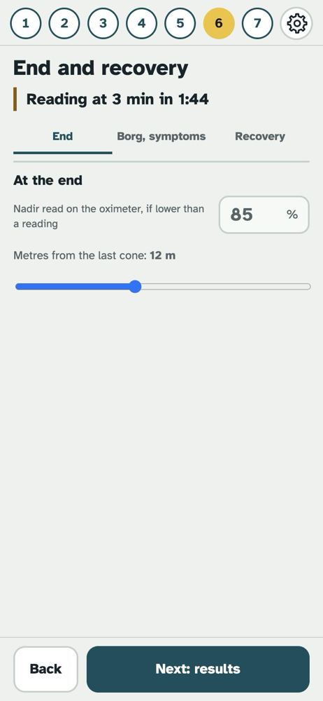
  &nbsp;
  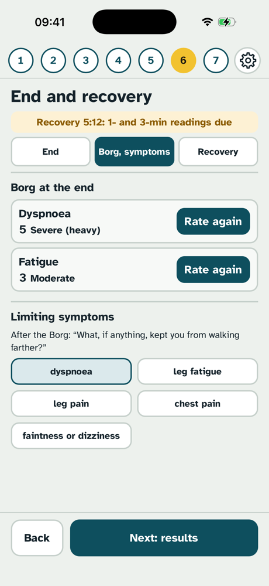
  &nbsp;
  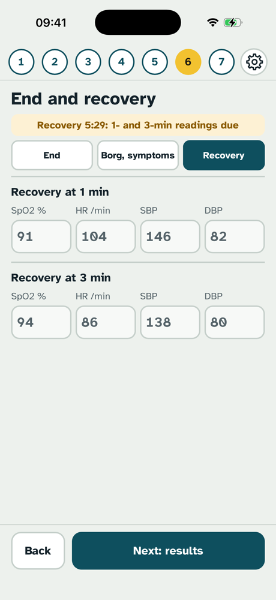

The **End** tab receives SpO2, HR and blood pressure at the end, and the slider gives the metres walked since the last cone. The **Borg, symptoms** tab holds the end-of-test rating, with a reminder of the rating before the test, then the symptoms that kept the patient from walking farther. The **Recovery** tab receives the readings at 1 and 3 minutes.

## 7. Results and report

The results bring together distance, lowest SpO2, highest HR and walking speed, then a figure of the course of the test, the summary, standard values and exploratory indices. If a value is missing, a "To complete before sending" list leads back to it in one tap.

  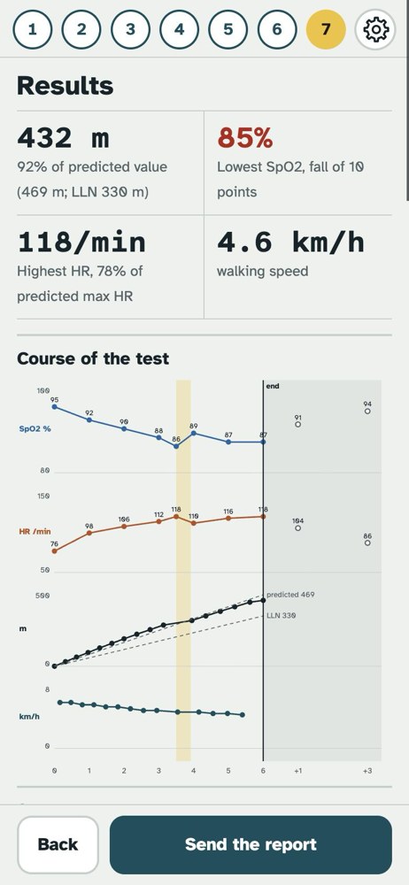
  &nbsp;
  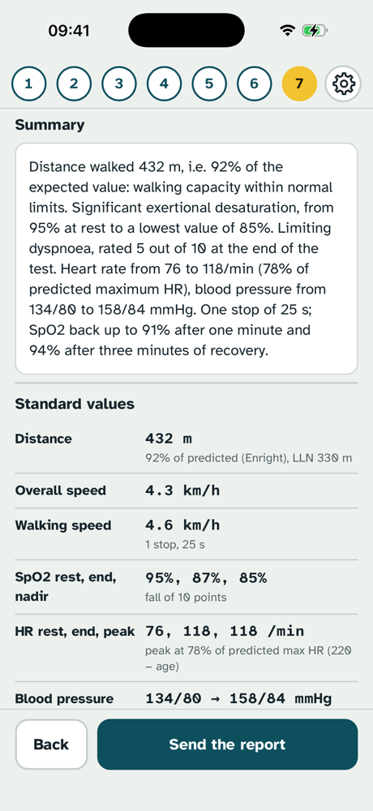
  &nbsp;
  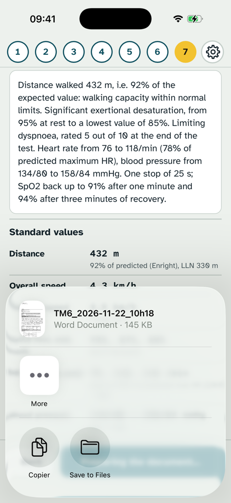

"**Send the report**" builds the Word document and opens the share sheet: choose Mail to send it, or "Save to Files" to keep it. In the web version, the recipient is not filled in: type the address in Mail. The document can be edited in Word before being sent. An [example report](exemples/example-report.pdf) is available.

Before the next patient, tap "New test", in the settings, at the bottom of the results or on the "Ready to start" screen, where it replaces START once the test is over. A test interrupted by closing the app or by a phone call is restored when the app is reopened, for up to 12 hours; a finished test is kept until the next "New test".

The detail of each calculation and its sources are in [METHODS.md](METHODS.md).
