# Premier test avec TM6

Ce guide accompagne un premier test de marche de 6 minutes avec TM6, de l'installation des réglages jusqu'à l'envoi du compte rendu. Les captures viennent d'un iPhone ; sur iPad, les étapes sont les mêmes, rangées dans une colonne à gauche de l'écran. Pour installer l'application, voir la [notice d'installation](Installer-TM6.docx) ou la partie « Installer » du [README](README.md).

Le test se déroule en sept étapes, numérotées en haut de l'écran. On peut toucher un numéro à tout moment pour revenir corriger une donnée, y compris pendant la marche, et rien ne bloque si une valeur manque : les calculs se refont dès qu'elle est saisie.

## Avant le premier patient : les réglages

La roue crantée, en haut à droite, ouvre les réglages. Ils se font une fois et sont conservés sur l'appareil.

  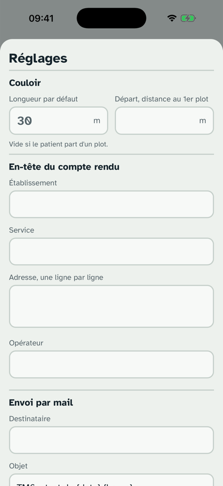
  &nbsp;
  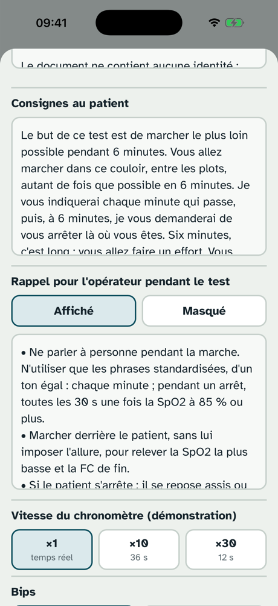

Il faut d'abord indiquer la **longueur du couloir**. Si le patient ne part pas d'un plot, par exemple depuis une salle située au milieu du couloir, on note aussi la **distance entre la ligne de départ et le premier plot** ; on laisse ce champ vide si le départ se fait à un plot. L'**en-tête du compte rendu** (établissement, service, adresse, opérateur) apparaîtra en haut du document Word.

Plus bas, les **consignes au patient** sont celles de la norme ERS/ATS ; elles peuvent être remplacées par le texte du service. Le **rappel pour l'opérateur** résume la conduite du test et peut être masqué. La **vitesse du chronomètre** doit rester sur « ×1, temps réel » pour un vrai test : les vitesses ×10 et ×30 ne servent qu'à essayer l'application.

Tout en bas, le bouton « Remplir un test d'exemple et ouvrir le bilan » charge un test fictif complet : c'est le moyen le plus rapide de voir le bilan et le compte rendu avant le premier patient. Le bouton « Nouveau test » efface le test en cours.

## 1. Patient

On choisit le sexe, puis on saisit l'âge, la taille et le poids. La distance théorique (équation d'Enright et Sherrill) et sa limite inférieure s'affichent dès que tout est renseigné.

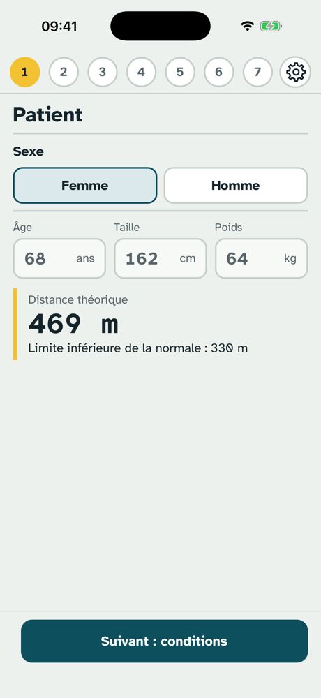

## 2. Conditions

On choisit le type d'examen, test de marche de 6 minutes ou titration de l'oxygène à l'effort, puis l'oxygène et l'aide à la marche. Si le patient est sous oxygène, de nouvelles listes apparaissent : interface, mode continu ou pulsé, débit ou réglage, source. La longueur du couloir est rappelée sous les listes, avec un lien pour la modifier.

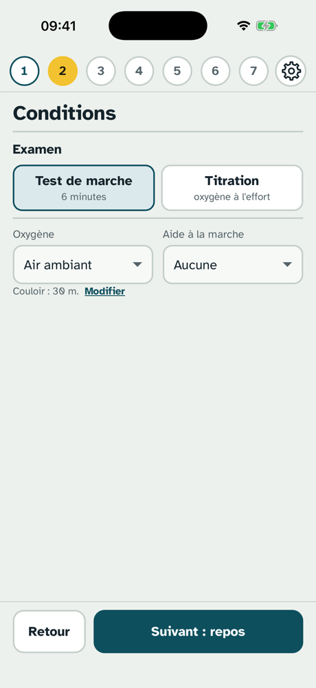

## 3. Repos

Le patient est assis au repos depuis au moins 15 minutes. On saisit la SpO2, la FC et la pression artérielle, puis on fait coter la dyspnée et la fatigue.

  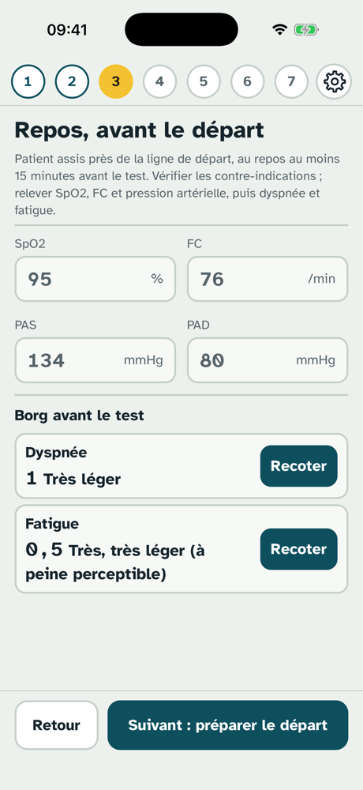
  &nbsp;
  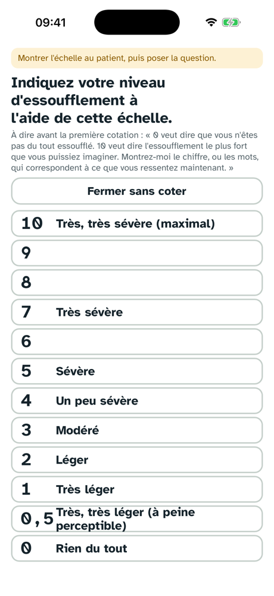

« Présenter l'échelle » affiche l'échelle de Borg en plein écran. On la tourne vers le patient, qui ne touche pas l'appareil : il montre ou dit sa cote, et c'est l'opérateur qui touche la ligne correspondante. La phrase à dire avant la première cotation est écrite en haut de l'échelle.

## 4. Prêt au départ

L'écran affiche les consignes à lire au patient. Les trois cases (consignes lues, oxymètre en place, patient sur la ligne de départ) sont un pense-bête et ne bloquent rien. Le chronomètre ne démarre qu'au toucher de **DÉPART**.

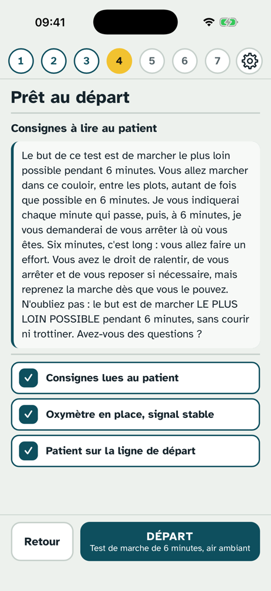

## 5. Test

Le chronomètre et le temps restant sont en haut, avec la phrase d'encouragement à dire au patient, qui change à chaque minute. À chaque passage du patient à un plot, on touche le grand bouton jaune **+1 aller** : l'heure de chaque passage sert à calculer la vitesse, et le couloir dessiné montre où se trouve le patient. « Annuler 1 » retire le dernier aller compté.

  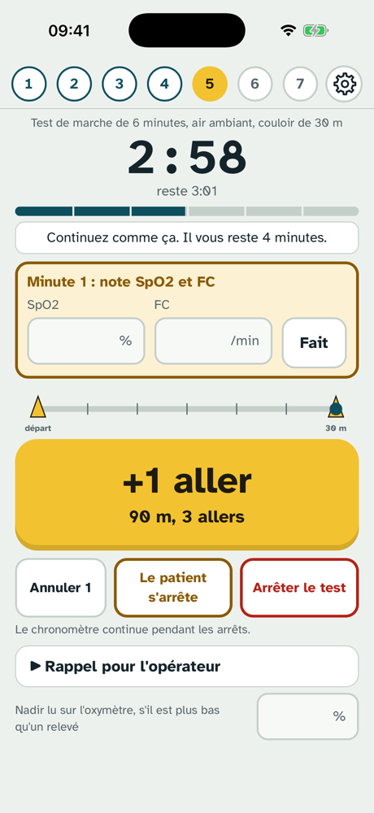
  &nbsp;
  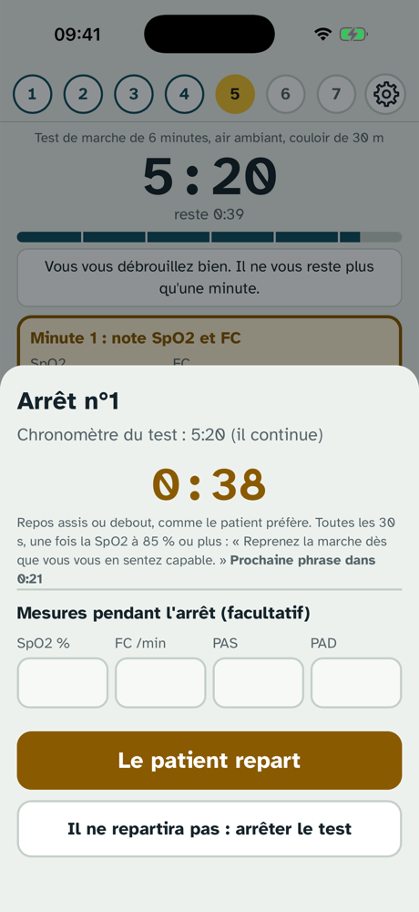

À chaque minute, une carte demande la SpO2 et la FC lues sur l'oxymètre ; on les saisit puis on touche « Fait ». Les six cases de 1 à 6 minutes restent modifiables, et on peut les compléter plus tard. Une SpO2 saisie sous 80 % déclenche une alerte d'arrêt de la marche, comme le prévoit la norme ERS/ATS de 2014.

Si le patient s'arrête, on touche « **Le patient s'arrête** ». Le panneau compte la durée de l'arrêt (le chronomètre du test continue), rappelle la phrase de reprise à dire toutes les 30 secondes une fois la SpO2 remontée à 85 %, et permet de noter des mesures facultatives. On touche ensuite « Le patient repart », ou « Il ne repartira pas : arrêter le test ». « Arrêter le test » interrompt le test pour une autre raison, avec un motif à choisir.

Le champ « Nadir lu sur l'oxymètre » sert à noter la SpO2 la plus basse affichée par l'oxymètre si elle est plus basse que les relevés de chaque minute.

## 6. Arrêt et récupération

À la fin des 6 minutes, l'application passe d'elle-même à cet écran et lance le minuteur de récupération. Le bandeau jaune indique le temps restant avant chaque relevé, et un bip retentit à 1 puis à 3 minutes. L'écran a trois onglets.

  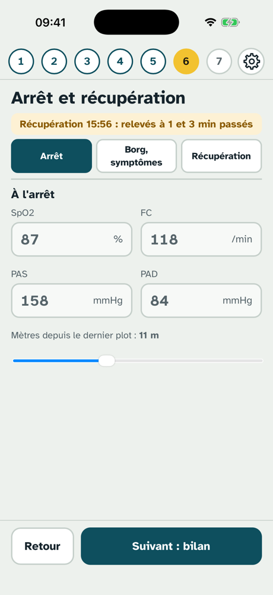
  &nbsp;
  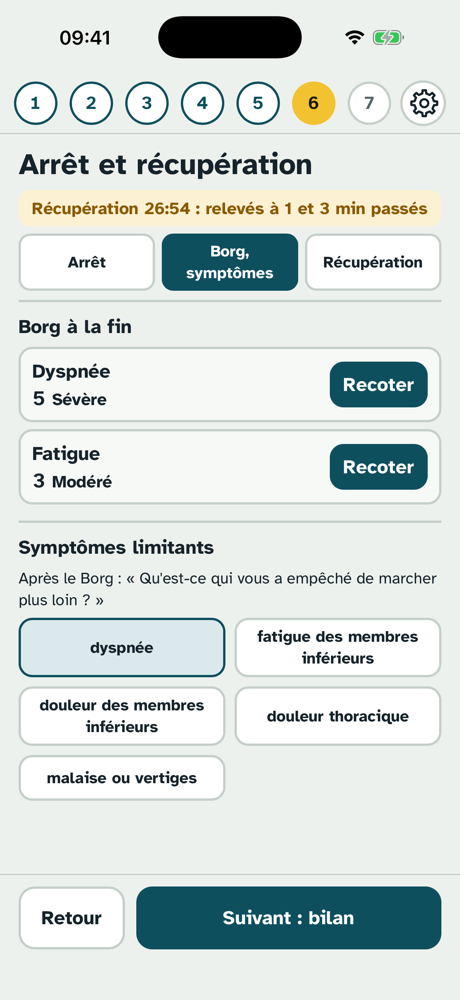
  &nbsp;
  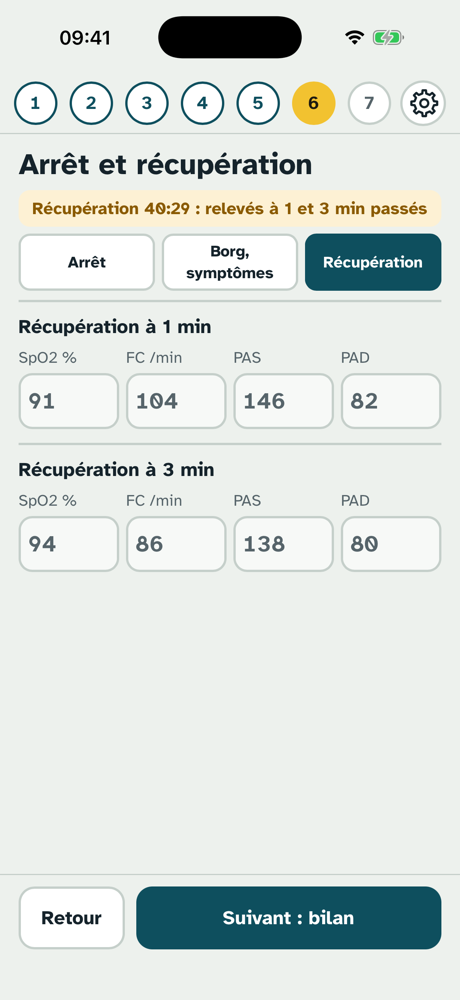

L'onglet **Arrêt** reçoit la SpO2, la FC et la pression artérielle à l'arrêt, et le curseur sert à indiquer les mètres parcourus depuis le dernier plot. L'onglet **Borg, symptômes** permet la cotation de fin, avec le rappel de la cote d'avant le test, puis les symptômes qui ont empêché le patient de marcher plus loin. L'onglet **Récupération** reçoit les relevés à 1 et à 3 minutes.

## 7. Bilan et compte rendu

Le bilan réunit la distance, la SpO2 la plus basse, la FC la plus haute et la vitesse de marche, puis une figure de l'évolution au cours du test, la synthèse, les valeurs usuelles et les indices exploratoires. S'il manque une donnée, une liste « À compléter » permet d'y revenir d'un toucher.

  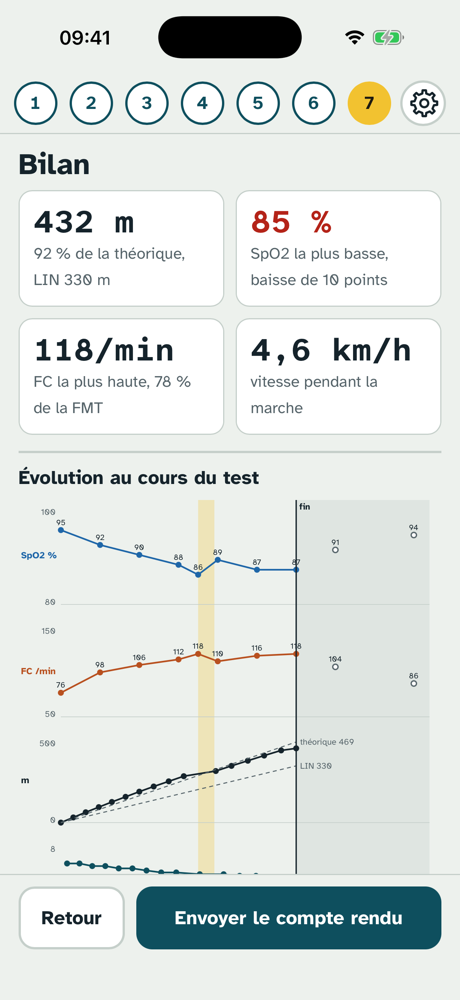
  &nbsp;
  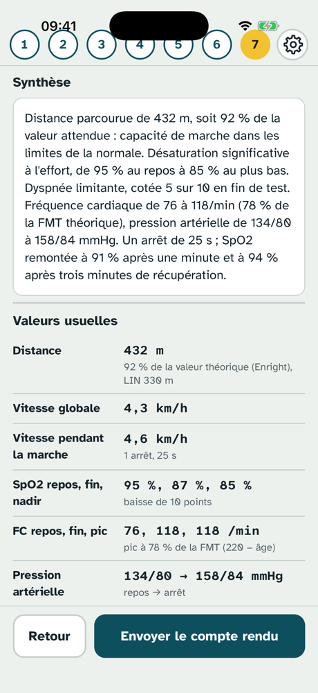
  &nbsp;
  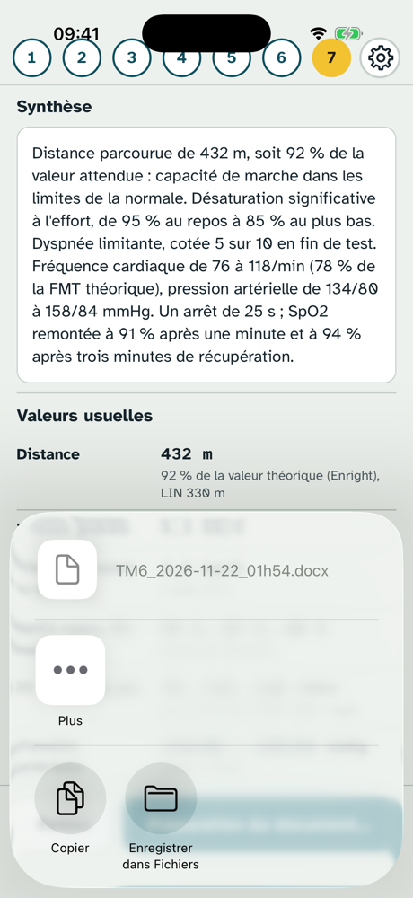

« **Envoyer le compte rendu** » fabrique le document Word et ouvre la feuille de partage : on choisit Mail pour l'envoyer, ou « Enregistrer dans Fichiers » pour le garder. Dans la version web, le destinataire n'est pas prérempli : on tape l'adresse dans Mail. Le document peut être retouché dans Word avant d'être envoyé. Un [exemple de compte rendu](exemples/compte-rendu-exemple.pdf) est disponible.

Avant le patient suivant, on touche « Nouveau test », dans les réglages ou en bas du bilan. Un test interrompu par une fermeture de l'application ou un appel est restauré à la réouverture pendant 12 heures.

Le détail de chaque calcul et ses sources sont dans [METHODES.md](METHODES.md).
